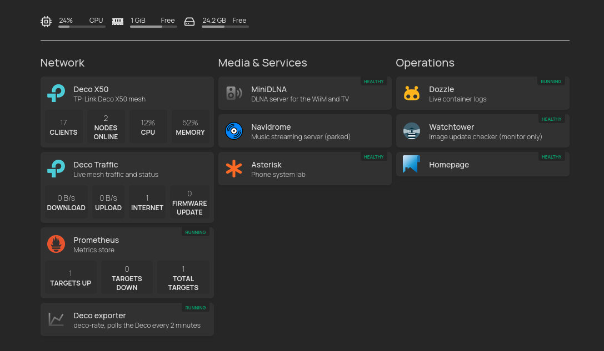

# ansible-lab

Ansible playbook and bootstrap script that rebuild a Docker-based homelab VM
(Ubuntu 26.04 LTS on VirtualBox).

## What it deploys
- Homepage dashboard, with Prometheus-backed widgets and container status
- Prometheus and deco-rate (metrics for a TP-Link Deco X50 mesh; the deco-rate
  source is pinned to a reviewed commit and built locally)
- MiniDLNA (DLNA music server for a WiiM streamer and a Samsung TV)
- Dozzle (live container logs, bound to localhost)
- Watchtower (checks for newer images, monitor only)
- Asterisk (phone system lab)
- Navidrome (music streaming, commented out in `site.yml`, uncomment to run)

## Design notes
- One reusable role, `roles/docker_app`, deploys any app from
  `files/<app>-compose.yml`. Adding an app is one line in the `site.yml` loop.
- No secrets in the repo. Real credentials live outside it and are mounted
  read-only into the containers.
- Containers that need no outside access publish no ports, and the exporter
  runs with a read-only filesystem and dropped privileges.

## What you provide yourself (not in the repo)
- `~/secrets/deco-rate.yaml`: the deco-rate config with your TP-Link login
- `asterisk/config/pjsip.conf`: copy `pjsip.conf.example` and set real passwords
- VirtualBox shared folders `sf_Music`, `sf_Songs`, `sf_Songs1` for MiniDLNA,
  or edit the paths in `files/minidlna-compose.yml`

## Usage
    git clone https://github.com/larenpeter/ansible-lab.git
    cd ansible-lab
    ansible-galaxy collection install -r requirements.yml
    bash scripts/bootstrap.sh

`bootstrap.sh` installs Ansible and Docker if missing, then runs the playbook.
To run the playbook directly: `ansible-playbook site.yml -K`

## Layout
- `site.yml`: main playbook (installs Docker, deploys the stacks)
- `requirements.yml`: Ansible collections needed (community.docker)
- `files/`: Docker Compose files for each app
- `homepage/config/`, `monitoring/config/`, `asterisk/config/`: app settings
- `roles/docker_app/`: role that deploys one Docker Compose app
- `scripts/bootstrap.sh`: prepares a fresh machine and runs the playbook
- `deployed-apps/`: generated on the target machine, not tracked in Git
